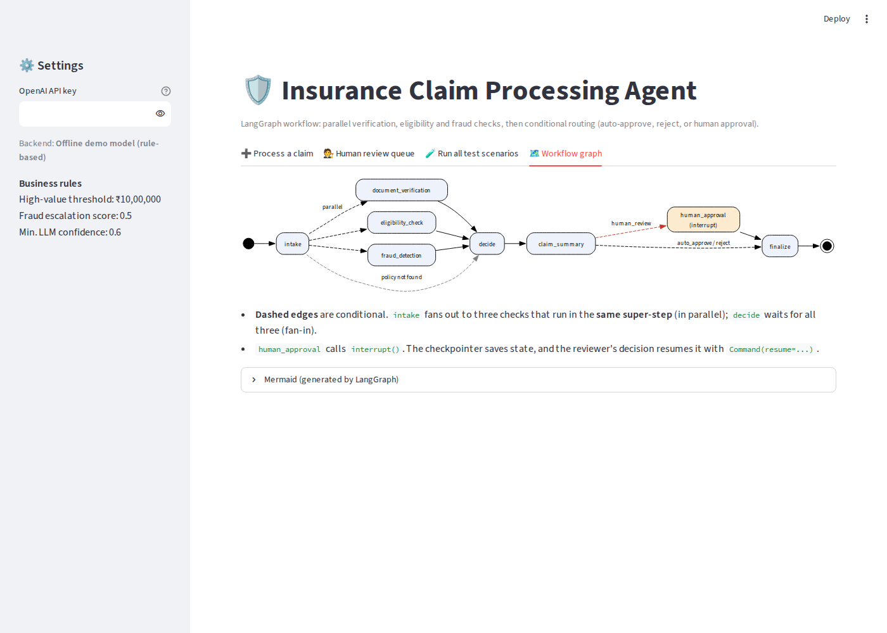

# Insurance Claim Processing Agent (LangGraph)

An AI agent that processes insurance claims. It verifies documents, checks policy eligibility and detects
fraud **in parallel**, writes a claim summary, and then auto-approves, rejects, or **pauses for a human
reviewer** (human-in-the-loop with LangGraph `interrupt()`).



## Agents (graph nodes)
| Node | Role |
|---|---|
| Document Verification Agent | Required documents present; names, amounts and dates consistent |
| Eligibility Check Agent | Policy active, incident in policy period, premium paid, peril covered, exclusions (LLM) |
| Fraud Detection Agent | 7 weighted rule flags + LLM narrative risk = fraud score |
| Claim Summary Agent | Adjuster-ready summary (LLM) |
| Human Approval Agent | `interrupt()` pauses the run; the reviewer's decision resumes it via `Command(resume=...)` |

The three checks run in the same LangGraph super-step (in parallel). Conditional edges route each claim to
auto-approve, reject, or human review.

## Test scenarios (`data/scenarios.json`)
| # | Scenario | Expected |
|---|---|---|
| 1 | Complete claim with valid documents | Auto-approve |
| 2 | Missing required documents | Reject |
| 3 | Suspicious claim amount | Human review |
| 4 | Expired policy | Reject |
| 5 | High-value claim with valid documents | Human review |
| 6 | Excluded peril (drunk driving) in the narrative | Reject |

## Run it online
Deployed on Streamlit Community Cloud. Without an OpenAI key the app runs in **offline demo mode**
(a rule-based stand-in model), so it always works. To use GPT-4o-mini, the app owner adds the key in
**App settings > Secrets**:
```toml
OPENAI_API_KEY = "sk-..."
```
The key is never shown on the page. Never commit a key to this repository.

## Run it locally
```bash
pip install -r requirements.txt
streamlit run app.py
python run_demo.py   # all 6 scenarios
pytest -q            # 12 tests
```

All people and policies in the sample data are fictional.
